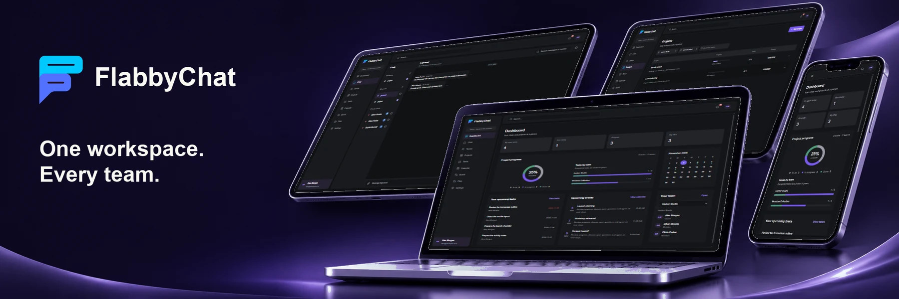

# FlabbyChat

## Overview

FlabbyChat brings team conversations, voice/video calls, projects, tasks, calendars, and shared files into one workspace. It supports authenticated cloud accounts and a guest demo with browser-local sample data.

## Project Preview



Application preview.

## Key Features

- Email/password accounts, verification, password reset, and profiles.
- Channels and private conversations with replies, favorites, unread state, and attachments.
- Private voice/video calls and call history.
- Team membership, projects, tasks, calendars, and discussion boards.
- Personal and team file libraries, image/PDF previews, and file transfer controls.
- Workspace summaries, notifications, and light, dark, or system themes.

## Live Website & Related Repository

https://flabby-chat.vercel.app/

## Tech Stack

- **Interface:** React 19, Vite 7, JavaScript, CSS, Lucide.
- **Services:** Firebase Authentication and Realtime Database, Cloudinary, WebRTC.
- **Documents and checks:** PDF.js, Vitest, React Testing Library.

## Prerequisites

Node.js matching `^22.13.0 || ^24.0.0 || >=26.0.0` and npm. Cloud accounts require Firebase; cloud file uploads require Cloudinary. The guest demo works without those services.

## Installation & Setup

1. Open the repository root and install dependencies:

   ```sh
   npm ci
   ```

2. For guest-demo use, proceed directly to Running Locally and choose **Try demo without an account**.
3. For cloud use, register a Firebase web application, enable Email/Password authentication, create a Realtime Database, and publish `database.rules.json` through the database Rules tab. Add the local/deployed host to Authentication's authorized domains.
4. Create a Cloudinary unsigned upload preset allowing JPG, PNG, WebP, GIF, and PDF. PDF delivery must be allowed in the provider settings.
5. Copy `.env.example` to `.env.local` and fill in `VITE_FIREBASE_API_KEY`, `VITE_FIREBASE_AUTH_DOMAIN`, `VITE_FIREBASE_DATABASE_URL`, `VITE_FIREBASE_PROJECT_ID`, `VITE_FIREBASE_APP_ID`, `VITE_CLOUDINARY_CLOUD_NAME`, and `VITE_CLOUDINARY_UPLOAD_PRESET`.
6. Use public web configuration only. Never place provider secrets in frontend variables. Restart Vite after environment changes.

## Running Locally

Development; open the address printed by Vite:

```sh
npm run dev
```

Build to `build/`, then preview:

```sh
npm run build
```

```sh
npm run preview
```

Run the test suite:

```sh
npm test -- --maxWorkers=1
```

Media calls require a secure context or localhost and camera/microphone permission. The current call configuration uses STUN without a TURN relay.

## Project Structure

```text
public/               # Static assets and README preview
src/
├── components/       # Account, chat, calls, collaboration, and files
├── hooks/            # Shared collaboration state
├── services/         # Firebase, uploads, and call signaling
├── styles/           # Workspace and component styles
├── tests/            # Component and service tests
├── utils/            # Calendar, data, theme, and demo helpers
└── App.jsx           # Session, verification, and demo entry
database.rules.json   # Realtime Database access rules
.env.example          # Public configuration template
```
